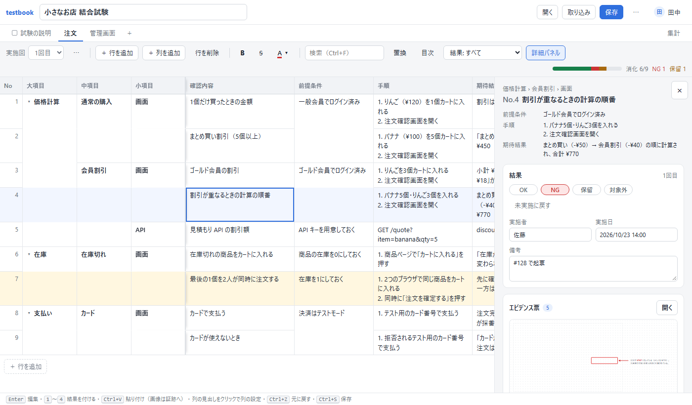
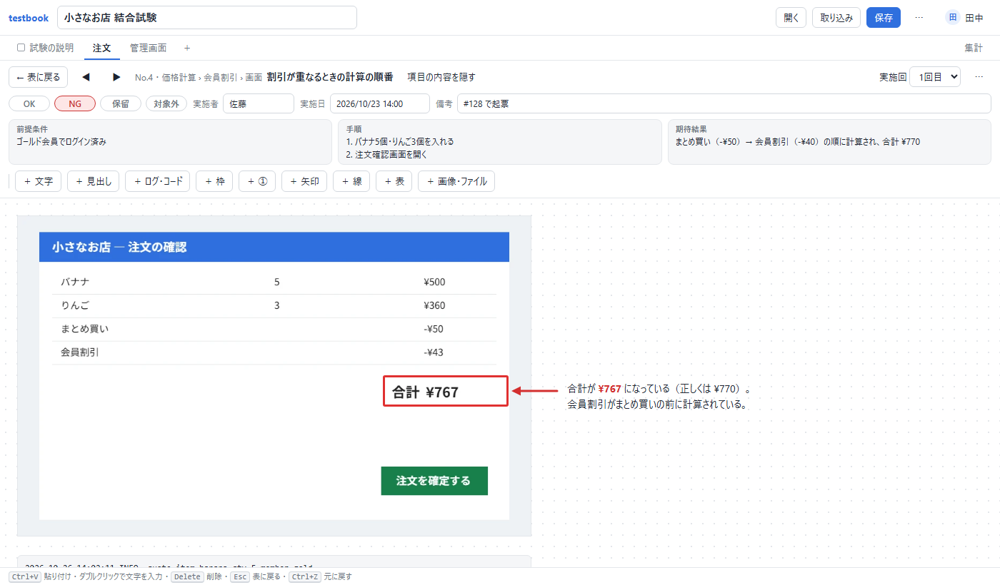

# testbook

[English](README.md) | 日本語

試験項目・結果・エビデンスを、**HTML 1ファイル**にまとめて管理するツールです。\
ブラウザで開くと、項目表、結果、赤枠や矢印を入れたスクリーンショット、集計がすべて1つの画面にそろいます。\
人に渡すときは、そのファイルを1つ送るだけです。\
実施回ごとの結果、エビデンス票、複数人のファイルをまとめる仕組み、集計など、試験に必要な機能をそろえています。

**インターネット接続も外部ライブラリも使いません。**\
オフラインや閉域網でもそのまま動き、データがファイルとブラウザの外に送られることはありません。



## 試し方

- **今すぐブラウザで試す**：[testbook を開き](https://gyuro-dev.github.io/testbook-html/testbook.html)、「サンプルで試す」を押してください。\
  このページは配布しているものと同じ HTML 1ファイルで、入力した内容をどこかへ送ることはありません。
- **サンプルのファイルを見る**：[shop-ja.html](https://gyuro-dev.github.io/testbook-html/samples/shop-ja.html) はアプリの「サンプルで試す」と同じ内容です。\
  [api-ja.html](https://gyuro-dev.github.io/testbook-html/samples/api-ja.html) は小さな2つ目の試験、[dashboard-ja.html](https://gyuro-dev.github.io/testbook-html/samples/dashboard-ja.html) はこの2つの消化状況をまとめたダッシュボードです。\
  英語版も [`samples/`](samples/) にあります。
- **実際の試験で使う**：[リリース](https://github.com/gyuro-dev/testbook-html/releases)から `testbook.html` をダウンロードし、試験の資料を置く場所にコピーして、Edge か Chrome で開きます。\
  インストールは要りません。

## かんたんな使い方

1. **試験項目を書く**：表に直接入力するか、ほかの資料の表をコピーして、表の上で `Ctrl+V` を押します。\
   列の名前や種類は、列の見出しから変えられます。
2. **結果を付ける**：結果の列で `1` を押すと OK、`2` で NG、`3` で保留、`4` で対象外になります。\
   実施者と実施日は自動で入ります。
3. **エビデンスを貼る**：スクリーンショットを撮り、その行を選んで `Ctrl+V` を押します。\
   画像はその行のエビデンス票に入り、赤枠・矢印・丸数字・メモを書き加えられます。
4. **保存する**：`Ctrl+S` を押します。\
   最初の1回だけ保存先を選びます（今開いているファイルを選ぶと、そのファイルに上書きします）。\
   2回目からは同じファイルに上書きし、入力が止まったときにも自動で保存します。
5. **共有する・報告する**：ファイルをそのまま送ります。\
   ほかの人が書いたファイルは、「取り込み」で今のファイルにまとめられます。\
   消化状況は「集計」のタブで確認でき、「⋯ → 報告書を印刷（PDF）…」で表とエビデンス票を印刷できます。



画面の言葉は日本語と英語に対応しています。\
最初はブラウザの言語設定に合わせて表示し、「⋯ → English / 日本語」でその場で切り替えられます（選んだ言語はそのブラウザが覚えます）。\
新しいファイルに最初から入っている名前（「大項目」などの列、「試験項目」のシート、「1回目」の実施回、題名）も、言語に合わせて切り替わります。\
自分で付けた名前や入力した内容は、そのまま表示します。

## 知っておくこと

- **対応ブラウザ**：ファイルへの上書き保存ができるのは Edge と Chrome だけです。\
  ほかのブラウザでは、保存するとファイルのダウンロードになります。
- **最初の保存**：保存先を聞かれます。\
  今開いているファイルを選ぶと、そのファイルに上書きします。\
  2回目からは聞かずに上書きします。
- **ファイルの大きさ**：画像が多いほどファイルは大きくなります。\
  メールで送れない大きさになったら、共有フォルダで受け渡してください。\
  大きなログや動画はファイルに入れず、保存場所のパスを文字で書いておくことをおすすめします。
- **下書き**：保存する前の変更は、ブラウザの中に下書きとして残り、次に開いたときに復元できます。\
  下書きが使えるのは同じ PC の同じブラウザだけで、ブラウザのデータを消すと下書きも消えます。
- **ファイル形式**：今の版は最初の公開版（0.1）です。\
  この版で保存したファイルは、今後の版でも開けるようにします。\
  古い形式のファイルは、開いたときに今の形式へ変換します。\
  ただし、最初期の試作版（ファイル形式 version 1）のファイルは開けません。
- **未対応の機能**：エビデンス票の拡大・縮小、エビデンス票での複数の要素の同時選択、表計算ソフトのファイルの直接の取り込み。\
  表計算ソフトのデータは、表をコピーして `Ctrl+V` で貼り付けてください。

## ライセンス

[MIT ライセンス](LICENSE)です。\
testbook は、商用利用も含めて自由に使用・改変・再配布できます。\
作った試験ファイルの扱いにも制限はなく、社外にも渡せます。\
試験ファイルにはアプリ本体の複製が入っていますが、この複製も MIT ライセンスのもとで配布できます（著作権とライセンスの表示はアプリ本体に入っています）。

## 詳しい使い方

### シートの種類

- **試験項目のシート**：表形式のシートです。\
  1行が1つの試験項目になります。
- **自由シート**：文字・画像・表などを自由に置けるボードです。\
  試験の説明、試験環境、前提条件、メトリクスなどをまとめるのに使います。
- シートのタブを右クリックすると、タブに色を付けられます。

### 試験項目のシート

- **列の設定**：列の見出しをクリックすると、列の名前・種類・並び順の変更、列の追加と削除、結合表示、列の固定、値での絞り込み、並べ替えができます。\
  見出しの右端をドラッグすると、列の幅を変えられます。\
  見出しどうしの境目や、No の列の行の境目にマウスを乗せると丸い「＋」が出て、その位置に列や行を追加できます。
  - 列の種類：テキスト、階層（同じ値をまとめて表示する列）、選択肢、日付、数値、チェック、ID
  - 結果の列：結果、実施者、実施日、備考、証跡。\
    これらの列は、実施回ごとに別の値を持ちます。
  - **ID の列**：行を追加するたびに、`TC-001` のような番号を自動で付けます。\
    行を移動しても削除しても番号は変わらないので、要件や不具合票から特定の試験項目を指せます。\
    接頭辞と桁数は列ごとに設定でき、「ID を上から振り直す」で付け直すこともできます。\
    2人が同時に行を追加して番号が重なったときは、ファイルを合わせる際に、あとから追加したほうの番号を付け直して知らせます。
- **詳細パネル**：表の右側に、選んだ行の内容・結果・エビデンス票・コメントを表示します。\
  「×」で閉じ、ツールバーの「詳細パネル」で再び開けます。
- **行と列の移動**：列は、見出しを横にドラッグすると移動できます。\
  行は、No の列をクリックして行を選んだあと、選んだ行の No の部分をドラッグすると移動できます。\
  今いる行は `Alt+↑` / `Alt+↓` でも移動できます。\
  並べ替えている間は、行を移動できません。
- **絞り込み**：結果（OK / NG / 保留 / 対象外 / 未実施）で絞り込めます。\
  ほかに「OK なのに証跡なし」「証跡なし」「証跡あり」、コメントのある行、実施回が2つ以上あるときは「前の実施回で NG」「前の実施回で NG で、まだ OK でない」も選べます。\
  列の見出しの「値で絞り込む…」では、その列にある値と件数の一覧から、表示する値を選べます。\
  どの絞り込みも、検索（`Ctrl+F`）と組み合わせて使えます。
- **折りたたみと目次**：大項目（左端の階層の列）の各グループの先頭行に ▾ が出ます。\
  押すとそのグループを折りたたみ、先頭行と件数だけを表示します。\
  ツールバーの「目次」を押すとグループの一覧が出て、選んだグループへ移動したり、すべて折りたたんだり開いたりできます。\
  折りたたんだ状態はファイルには保存せず、ブラウザが覚えます。
- **置換**：`Ctrl+H`（ツールバーの「置換」）で、表に表示している行の文字の列を置き換えます。\
  範囲を選んでいるときは、その範囲の中だけを置き換えます。\
  置き換えは `Ctrl+Z` 1回でまとめて元に戻せ、文字単位の書式は置き換えたあとも残ります。
- **並べ替え**：列の見出しの「昇順に並べ替え」「降順に並べ替え」で並べ替えます。\
  並べ替えは表示だけで、ファイルの中の行の順番は変わりません（ツールバーの「並べ替え中 … ×」で元の順に戻ります）。\
  数値は数値として比べ（2 は 10 より前）、空のセルは最後に並びます。\
  絞り込みや検索と組み合わせて使えます。
- **結合表示**：上の行と同じ値のセルを、結合したように表示します。\
  階層の列は、左側の階層の値もすべて同じとき（同じグループのとき）だけ結合するので、グループの境目をまたいで結合することはありません。\
  結合表示は列ごとにオン・オフできます。
- **列の固定**：横にスクロールしても、No の列と左側の階層の列は固定されたままです。\
  固定する範囲は、列の見出しの「ここまでの列を固定」で変えられます。
- **キー操作**
  - `Enter` で編集、`Alt+Enter` でセルの中で改行
  - `Ctrl+Enter` で下に行を追加（階層の値を引き継ぎます）、`Ctrl+Shift+D` で行を複製
  - `Ctrl+Z` で元に戻す、`Ctrl+Y` でやり直す
- **範囲選択**：`Shift+矢印キー`、`Shift+クリック`、ドラッグで範囲を選べます。\
  No の列をクリックまたはドラッグすると、行単位で選べます。\
  `Ctrl+A` ですべてを選びます。
  - `Ctrl+C` / `Ctrl+X` で範囲をコピー・切り取り（タブ区切りの文字になるので、ほかの表にも行と列のまま貼り付けられます）
  - `Ctrl+V` で貼り付け。\
    貼り付ける値が1つだけのときは、選んだ範囲のすべてのセルに入ります。
  - `Delete` で範囲の値を消去、`Ctrl+D` で上の値を下へコピー
  - 編集中に `Ctrl+Enter` を押すと、選んだ範囲のすべてのセルに同じ値が入ります
  - 結果の列で複数の行を選んで `1`〜`4` を押すと、まとめて結果を付けられます
- **表の貼り付け**：ほかの資料の表をコピーして `Ctrl+V` を押すと、試験項目の行として貼り付けられます。\
  結果の列にある「OK」「NG」「保留」「対象外」（英語の「Hold」「N/A」も可）は、キーで付けたときと同じく、実施者・実施日・履歴付きで入ります。
- **結果**：結果の列で `1` を押すと OK、`2` で NG、`3` で保留、`4` で対象外、`0` で未実施に戻ります。\
  対象外の行は灰色、保留の行は黄色で表示します。\
  実施者と実施日は自動で入ります。\
  手で書き直した実施者や実施日は、結果を付け直しても上書きしません。
- **書式**：選んだセルに、太字（`Ctrl+B`）、取り消し線（`Ctrl+5`）、文字の色を付けられます。\
  `Enter`、`F2`、ダブルクリックでセルを編集状態にすると、選んだ文字だけに書式を付けられます。
- **不具合票へのリンク**：「⋯ → 不具合票のリンク…」で URL のひな形を設定すると、備考などに書いた `#128` や `PROJ-12` が不具合票へのリンクになります。\
  ひな形は、GitHub なら `https://github.com/example/shop/issues/{n}`、Jira なら `https://jira.example.com/browse/{key}` のように書きます。\
  `https://` で始まる URL は、設定しなくてもリンクになります。
- **結果の履歴**：結果を変えるたびに、誰が・いつ・どの結果に変えたかを記録します（結果ごとに直近10件）。\
  記録は詳細パネルの「結果の履歴」に表示され、セルにマウスを乗せると最後に変えた時刻が出ます。
  - 打ち間違いは記録に残しません。\
    同じ人が2分以内に付け直したときは前の記録を書き換え、元の値に戻したときは記録ごと消します。
  - 履歴は、1件ずつ、試験項目ごと（「履歴を消す」）、ファイル全体（「⋯ → 結果の履歴をすべて消す…」）の単位で消せます。\
    消したことも記録するので、ほかの人のファイルと合わせても、消した履歴は戻りません。
  - 記録は1件あたり約 50 バイト、結果ごとに最大10件なので、ファイルが大きくなりすぎることはありません。
- **コメント**：試験項目やセルに、レビューの指摘などのコメントを付けられます。\
  詳細パネルの「コメント」欄に書いて `Ctrl+Enter` で付けます（`Ctrl+M` で入力欄へ移動します）。\
  未解決のコメントがあるセルには、右上の角に印が付きます。\
  対応が済んだらチェックを付けて解決にし、残りは「未解決のコメントあり」の絞り込みで確認します。
- **実施回**：「1回目」「回帰」のように、同じ試験項目をもう一度試験したときの結果を分けて記録します。\
  1回しか試験しないなら、使わなくてかまいません。\
  実施回を追加するときは、前の実施回の結果の扱いを次の3つから選べます。
  - 引き継がない（すべて未実施から始める）
  - 前回 NG と未実施だけをやり直す（前回 OK・対象外だった行は、理由を備考に書いて対象外にする）
  - 前回の結果をそのまま引き継ぐ
- **実施回の削除**：実施回の選択欄の横の「⋯」から、今の実施回を削除できます。\
  その回の結果とエビデンス票も一緒に削除されます（`Ctrl+Z` で元に戻せます）。\
  最後に残った1つの実施回は削除できません。

### エビデンス票

試験項目ごと・実施回ごとに1枚ある、スクリーンショットやメモを自由に置けるボードです。\
表の証跡の列をクリックすると開きます。

- スクリーンショットは `Ctrl+V` で貼り付けます（自動で圧縮します）。\
  表で行を選んで `Ctrl+V` を押しても、その行のエビデンス票に入ります。
- 何もないところをダブルクリックすると、文字を書けます。\
  文字には「見出し」と「ログ・コード」（等幅のフォント）の書式もあります。\
  テキストボックスを選ぶと、太字・取り消し線・文字の色・枠線・「文字をコピー」が使えます。\
  編集中は、選んだ文字だけに書式を付けられます。
- 枠、丸数字の印（①②③。番号と色を変えられます）、矢印・線、表、ファイル（10MB まで）も置けます。\
  コピーした表を貼り付けると、表の要素になります。
  - 枠は中を黒や白で塗りつぶせるので、スクリーンショットの個人情報を隠せます。
  - 矢印や線を選ぶと両端につまみが出て、向きと長さを変えられます（`Shift` を押しながらだと水平・垂直になります）。
- 要素はドラッグで移動し、右下の角をドラッグして大きさを変えます。\
  `Delete` で削除、`Ctrl+D` で複製します。\
  画像を動かすと、画像の上に置いた枠・丸数字・矢印・文字も一緒に動きます。
- ◀ ▶ で前後の試験項目のエビデンス票へ移ります。\
  表を絞り込んでいる（NG だけ、証跡のない行だけ、など）ときは、絞り込んだ行の中で移ります。
- 選んだ要素は `Ctrl+C` / `Ctrl+X` でコピー・切り取りし、別のエビデンス票、自由シート、同じブラウザで開いている別のファイルに貼り付けられます。
- 何も選んでいないときに `Esc` を押すと、表に戻ります。\
  エビデンス票の上部には試験項目の内容が表示され、結果・実施者・実施日・備考もそこで書けます。\
  「項目の内容を隠す」で、項目の内容を折りたためます。

### 集計と報告書

- 「集計」のタブには、次の内容を表示します。
  - シート・大項目・実施回・実施者ごとの件数と消化率
  - 証跡のある行の数（「OK なのに証跡なし」を含む）
  - 前の実施回で NG だった行が、今の実施回でどうなったか（実施回が2つ以上あるとき）
  - 日ごとの消化数（グラフと表）
  - 未解決のコメントの数
- 「⋯ → 報告書を印刷（PDF）…」で、表・集計・エビデンス票・未解決のコメントを並べた報告書を作り、ブラウザの印刷画面を開きます。\
  エビデンス票を含めるかどうかは選べます。\
  印刷画面で「PDF に保存」を選ぶと PDF になります。
- 自由シートにほかの testbook のファイルをドラッグするか、「＋ ほかの試験の集計」でファイルを選ぶと、そのファイルの実施回ごとの消化状況がカードとして置かれます。\
  同じファイルをもう一度ドラッグすると、数字が最新になります。\
  「＋ 全部の合計」を置くと、置いたカードをすべて合計したカードになります。\
  機能ごとに試験ファイルを分けている場合は、これで1ファイルのダッシュボードを作れます。
- 「⋯ → このシートを CSV で書き出す」で、今のシートを、今の実施回の結果を含めて CSV に書き出します。

### 複数人で書くとき

試験項目・結果・エビデンスなどのデータは、それぞれ固有の ID を持ち、値（フィールド）ごとに書き込んだ時刻を記録しています。\
ファイルを合わせるときは、フィールドごとに新しいほうの値を残します。

- **ファイルを受け渡すとき**：受け取ったファイルを画面にドラッグします（「取り込み」ボタンでも同じです）。\
  同じデータが2重に入ることはなく、取り込んだ内容の件数（「項目 5・結果 30・エビデンス 12・コメント 2」など）を表示します。
- **共有フォルダの1つのファイルを使うとき**：保存の直前に保存先の最新の内容を読み込み、自分の変更と合わせてから書き込みます（自動保存のときも同じです）。\
  ファイルを開いている間も、ほかの人が保存した変更を20秒ごとに取り込みます。
- 結果の履歴は時刻順に合わせ、コメントは双方のものを残し、重なった ID の番号は付け直します。

ファイルを合わせるための専用の画面はありませんが、**データを知らないうちに捨てることはありません**。

- **同じセルを2人が別々に直したとき**：新しいほうの値を表示し、もう一方の値は「競合」として残します。\
  画面の上部に「⚠ 競合 N」が出るので、どちらの値を使うか選んでください。\
  相手の値を見たうえで直した（順番に直した）場合は、競合になりません。
- **削除した行や実施回に、削除のあとで結果やエビデンスが付けられていたとき**：削除を取り消して残し、競合として知らせます。\
  「削除する」か「残す」かを選んでください。
- **PC の時計がずれているとき**：自分の変更には、取り込んだほかの人の変更より必ず後の時刻を付けます。\
  そのため、新しい変更が古いものとして扱われることはありません。
- **列の設定**は列ごとに合わせるので、2人が別々の列を変えても、両方の変更が残ります。

## 開発者向け

### ファイルの中身

保存したファイルは、次の3つの部分でできています。

1. **データ**：`tb-data` の script 要素に入った JSON です。\
   画像以外のデータはすべてここに入ります。
2. **画像とファイル**：`tb-blob` の script 要素です。\
   画像やファイル1つにつき1つあり、data URL の形で中身を持ちます。
3. **アプリ本体**：`tb-app` の script 要素です。\
   画面の HTML / CSS / JavaScript が入っていて、誰が開いても同じ画面になります。

ブラウザには、1つの文字列の長さに約 512MB の上限があります。\
そのため画像は JSON に入れず、別の要素に分けています。\
こうすることで数 GB のファイルでも開け、画像はエビデンス票を開くまで読み込みません。

| 名前 | 中身 |
|---|---|
| `meta` | 試験の名前、試験の ID、不具合票の URL のひな形 |
| `sheets` | シート（種類、列の定義、次に付ける ID の番号） |
| `runs` | 実施回 |
| `items` | 試験項目（行）。列ごとの値 |
| `records` | 結果（試験項目 × 実施回ごとに1つ。結果、実施者、実施日、備考、結果の履歴） |
| `elements` | エビデンス票と自由シートに置いた要素（文字、画像、枠、丸数字、線、表、ファイル、集計カード）。画像とファイルの中身は `tb-blob` に入る |
| `comments` | コメント（試験項目、列、本文、書いた人、書いた日時、解決済みか） |
| `conflicts` | ほかの人の変更との競合。解決すると削除済みの印が付く |

- 削除したデータは、ID と削除済みの印だけを残します。\
  画像などの中身は、保存するときに捨てます。
- 次の情報はファイルに入れず、その PC のブラウザが覚えます：自分の名前、保存先、自動保存のオン・オフ、表示の言語、折りたたんだグループ、保存していない下書き。

### 大きなデータでの性能

動作を軽くするための工夫：

- 画面に見えている行と、その前後の数行だけを描画します。\
  行の位置は Fenwick 木で管理するので、ある行の高さが変わっても、全部の行を計算し直しません。
- 消化数や、結果・証跡の索引はあらかじめ作っておき、変わった分だけを更新します。\
  値を直したときは、その行だけを描き直します。
- 画像はエビデンス票を開いたときだけ読み込み、表には描画しません。
- ファイルは少しずつ読み書きし、全体を1つの巨大な文字列にはしません。\
  自動保存でも JSON を少しずつ作り、その間も画面の操作を止めません。
- 絞り込み・折りたたみ・検索で全部の行を調べるのは、条件が変わったときだけです。\
  行や列をドラッグしている間は線を1本表示するだけで、手を離すまで表を描き直しません。

次の表は、`bench/bench.js` を使い、Chromium 系のブラウザで測った結果です。\
測定に使った1行には、階層3つ、確認内容、前提条件、手順3つ、期待結果、結果が入っています。

| 行数 | ファイル | 読み込み | 最初の表示 | 1回のスクロール | セルの編集 | 結果を付ける | 範囲を消す（200行×3列） | 保存 |
|---:|---:|---:|---:|---:|---:|---:|---:|---:|
| 10,000 | 5.8 MB | 0.02 秒 | 0.03 秒 | 5 ms | 9 ms | 6 ms | 7 ms | 0.04 秒 |
| 100,000 | 57 MB | 0.2 秒 | 0.2 秒 | 5 ms | 6 ms | 5 ms | 7 ms | 0.4 秒 |
| 500,000 | 284 MB | 1.0 秒 | 1.0 秒 | 5〜11 ms | 6 ms | 4 ms | 5 ms | 1.8 秒 |

| 画像（1枚 約 140KB） | ファイル | 読み込み | 最初の表示 | セルの編集 | 票を開く | 保存 |
|---:|---:|---:|---:|---:|---:|---:|
| 3,000（2,000行） | 409 MB | 0.5 秒 | 0.05 秒 | — | 4 ms | 0.7 秒 |
| 6,000（2,000行） | 818 MB | 1.1 秒 | 0.01 秒 | 6 ms | 5 ms | 1.5 秒 |

- 画像以外のデータ（JSON）は1つの文字列になるため、480MB を超える場合（80万行程度）は保存を中止します。\
  ファイルが 1GB を超えたときは、警告を表示します。
- 行数に比例して時間がかかる操作（50万行のとき）：行の追加・削除・移動（ドラッグでも `Alt+↑↓` でも 0.25〜0.35 秒）、表示の言語の切り替え（0.25 秒）、検索（0.7 秒）、列の移動（0.7 秒）、集計画面の表示（0.8〜1.9 秒）、結果が35万件ある実施回の削除（1.2 秒）。

#### 実際の Edge で開いたときの時間とメモリ

最初の公開の前（2026-10-31）に測り直しました。\
英語の画面・ドラッグでの移動・実施回の削除を足す前の版と比べて、どの数字も誤差の範囲で同じです。\
PowerShell で大きなファイルを作り、使い捨てのプロファイルで、画面を出さない Edge で開いて測りました（メモリ 128GB の PC）。\
「Edge 全体」は、その Edge のすべてのプロセスが使ったメモリの合計です。

| ファイル | 大きさ | 開く | Edge 全体（最大） | Edge 全体（落ち着いたあと） | うち JavaScript | 編集 | 結果を付ける | 1回のスクロール | 票を開く | 保存の準備 |
|---|---:|---:|---:|---:|---:|---:|---:|---:|---:|---:|
| 空 | 0.3 MB | 0.28 秒 | 337 MB | 339 MB | 2 MB | — | — | — | — | 0.002 秒 |
| 10万行 | 46 MB | 0.8 秒 | 842 MB | 831 MB | 115 MB | 0.6 ms | 7 ms | 8 ms | — | 0.3 秒 |
| 50万行 | 231 MB | 2.8 秒 | 2.0 GB | 2.0 GB | 308 MB | 0.6 ms | 7 ms | 6 ms | — | 1.4 秒 |
| 画像 3,000枚（2,000行） | 1.2 GB | 3.5 秒 | 2.9 GB | 1.8 GB | 8 MB | 0.6 ms | 7 ms | 9 ms | 8 ms | 2.3 秒 |
| 画像 6,000枚（2,000行） | 2.3 GB | 6.6 秒 | 5.9 GB | 3.2〜5.1 GB | 9 MB | 0.5 ms | 9 ms | 20 ms | 9 ms | 5.0 秒 |

- **行が多いとき**：Edge 全体で、ファイルの大きさの7〜10倍のメモリを使います。\
  50万行では約 2GB です。
- **画像が多いとき**：画像はエビデンス票を開くまで読み込まないので、JavaScript のメモリはほとんど増えません。\
  Edge 全体のメモリは、開いている最中はファイルの大きさの約 2.5 倍まで増え、そのあと約 1.5〜2 倍で落ち着きます。
- **目安**：メモリが 8GB の PC なら、画像の多い試験はファイルの大きさ 1GB まで、行の多い試験は30万行までが目安です。
- 測り直すときは、次のコマンドを実行します。

  ```
  powershell -ExecutionPolicy Bypass -File bench\make-big.ps1 -Rows 100000 -Images 0 -Out big.html -Measure
  powershell -ExecutionPolicy Bypass -File bench\run-edge.ps1 -File big.html
  ```

### 自動試験

`test\` に、アプリ全体の自動試験があります。\
Node などのインストールは要りません。\
PC に入っている Chrome（なければ Edge）を画面を出さずに起動し、使い捨てのプロファイルで試験を実行します。\
GitHub Actions でも、push と pull request のたびに、Linux と Windows の Chrome で同じ試験を実行します。

```
powershell -ExecutionPolicy Bypass -File test\run.ps1      Windows
bash test/run.sh                                          macOS / Linux
```

- `-Filter マージ`（`--filter マージ`）を付けると、名前に「マージ」を含む試験だけを実行します。\
  `-Show`（`--show`）を付けると、画面のあるブラウザと開発者ツールが開きます。\
  `-Browser edge` や `TB_BROWSER=パス` で、使うブラウザを指定できます。
- すべて通ると `174 件 OK` のように表示して終了コード 0 で終わり、失敗があると NG の内容を表示して終了コード 1 で終わります。
- 表示やファイル形式を意図して変えたときは、`-Update`（`--update`）を付けて実行します。\
  `test\golden\` の正解ファイルと `samples\` のファイルが書き換わるので、`git diff` で変わった内容を確かめます。

#### 仕組み

`testbook.html` の `tb-app` の直前に `test\harness.js` と `test\tests\*.js` を差し込んだページを一時フォルダに作り、ブラウザで開きます。\
試験はアプリと同じスコープで動くので、`mergeInto` や `setF` などの関数を呼んだり、開いている試験のデータ `D` を直接調べたりできます。\
画面の操作は、実際の要素にキー・マウス・クリップボードのイベントを送って再現します。\
試験の結果は `console.log` に出し、ランナーがブラウザのログから読み取ります。

```js
TB.test('マージ: 2人が別のセルを直したら両方残る', () => {
  const b0 = base();                                                     // 共通の出発点
  const tanaka = TB.user(b0, '田中', () => setF(TB.item(1), K, '田中の値'));  // 田中さんが開いて直して保存
  const sato = TB.user(b0, '佐藤', () => setF(TB.item(2), K, '佐藤の値'));
  loadDoc(tanaka); mergeInto(D, sato);                                   // 田中さんが佐藤さんのファイルを取り込む
  TB.eq(TB.item(2)[K], '佐藤の値');
});
```

- **基本の試験**（`merge.js`、`file.js`、`undo.js`）：この README に書いた動作を1つずつ確かめます。\
  2人分のランダムな編集をどちらの向きに合わせても同じ結果になるかを確かめる、性質の試験も含みます。
- **画面の試験**（`ui-*.js`）と**機能ごとの試験**（`feat-*.js`）：この README に書いた操作を、キー・クリック・ドラッグで実際に行って確かめます。
- **ゴールデン試験**（`golden.js`）：サンプルの保存データ・CSV・表の表示・集計・競合の文言を、正解として置いたファイルと比べます。\
  時刻と乱数はハーネスが固定するので、毎回同じ結果になります。\
  日時は日本時間で作っているので、`run.sh` と GitHub Actions はタイムゾーン（TZ）を日本時間にしています。
- **言語の試験**（`i18n.js`）：アプリのソースから `_t('…')` のキーをすべて集め、英語の対応表にすべてのキーがあること、`{0}` などのプレースホルダーが一致すること、使われていないキーがないことを確かめます。\
  あわせて、英語で表示した画面に日本語が残っていないかも確かめます。
- **サンプルの試験**（`samples.js`）：`samples\` のファイルを今のアプリから作り直し、リポジトリにあるものと比べます。\
  これにより、サンプルがアプリより古いままになることを防ぎます。
- **文書の試験**（`docs.js`）：`APP_VERSION` と CHANGELOG の版が一致するか、README の日本語版と英語版の見出しの構成が同じか、上に書いた試験の件数が正しいかを確かめます。

試験を追加するときは、`test\tests\` に `.js` ファイルを置くか、既存のファイルに `TB.test(名前, 関数)` を追加します。\
どの試験も空の試験ファイルから始まり、ダイアログは表示せずに「OK」と答えます（答えを変えたいときは `window.dialog` を差し替えます）。

### リポジトリの構成

| 場所 | 中身 |
|---|---|
| `testbook.html` | アプリ本体です。利用するのも、リリースで配布するのも、この1ファイルです。 |
| `samples/` | サンプルのファイルです。自動試験が作ります。 |
| `test/` | 自動試験と、それを実行するスクリプトです。アプリを直すときは、これだけ使えば足ります。 |
| `bench/` | 上の性能の数値を測るためのスクリプトです（大きなファイルの作成と計測。PowerShell とブラウザのコンソールで使います）。 |
| `.github/` | CI と公開用のワークフロー、その補助スクリプトです（`v*` のタグを付けると、`testbook.html` と SHA-256 を公開します）。 |
| `docs/images/` | この README のスクリーンショットです。 |
