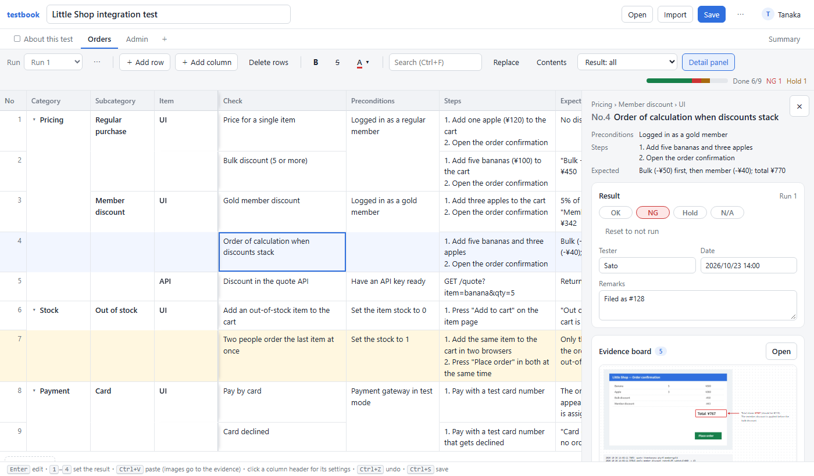
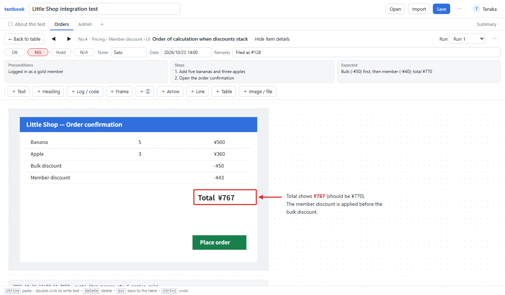

# testbook

English | [日本語](README.ja.md)

A tool that keeps test cases, results and evidence in **one HTML file**.
Open the file in a browser and the case table, the results, the screenshots with red frames and arrows, and the summary are all there.
To hand it over, send that one file.
It has what testing needs: results per run, evidence boards, merging other people's copies, and a summary.

**No internet connection and no external libraries.** It runs fully offline, also in closed networks, and your data never leaves the file and your browser.



## Try it

- **In the browser right now**: [open testbook](https://gyuro-dev.github.io/testbook-html/testbook.html) and press "Try the sample". Nothing is sent anywhere; the page is just the same single file.
- **Ready-made samples**: [shop-en.html](https://gyuro-dev.github.io/testbook-html/samples/shop-en.html) (the built-in sample), [api-en.html](https://gyuro-dev.github.io/testbook-html/samples/api-en.html) (a second, smaller test) and [dashboard-en.html](https://gyuro-dev.github.io/testbook-html/samples/dashboard-en.html) (cards with the progress of the other two). The Japanese versions are in the [list of samples](samples/README.md).
- **For real work**: download `testbook.html` from the [releases](https://github.com/gyuro-dev/testbook-html/releases) and open it in Edge or Chrome. Nothing to install. One test is one file: keep `testbook.html` as an empty template, open it whenever you start a test, and the first save creates that test's file.

## Quick start

1. **Write the cases.** Type into the table, or copy a table from another document and press `Ctrl+V` on it. Columns are yours to change from the column header.
2. **Set the results.** In the result column press `1` OK, `2` NG, `3` Hold, `4` N/A. Tester and date are filled in for you (you are asked for your name once).
3. **Attach evidence.** Take a screenshot and press `Ctrl+V` on the row. It lands on that row's evidence board, where you can add red frames, arrows, numbered markers and notes.
4. **Save.** Give the test a title at the top left, press `Ctrl+S` and save into the folder with your test documents. You choose the location only the first time, and the file name is the title. From then on it saves in place, and it also saves by itself when you stop typing. `testbook.html` stays empty, ready for the next test.
5. **Share and report.** Send the saved file. To have others fill it in too, hand out this file and merge the copies that come back with "Import". The "Summary" tab shows the progress, and "⋯ → Print report (PDF)…" prints the tables and boards.



The UI is in English or Japanese. It follows the browser language, and "⋯ → 日本語 / English" switches it on the spot. The names a new file starts with (columns such as "Category", "Run 1") follow the language too; names and text you type stay as they are.

## Good to know

- **Browsers**: overwriting the file works in Edge and Chrome. Other browsers show "This browser cannot overwrite files" at the top and download a copy when you save. If your default browser is a different one, right-click the file and choose "Open with" → Edge or Chrome.
- **Permission to overwrite**: after the browser is restarted, the first save may ask whether the page may edit the file. Until you allow it, autosave does not overwrite the file: the top bar says "save with Ctrl+S", and changes are kept as a draft in the browser.
- **Copied files**: when you open a copy of a test file (copied or renamed), the first save asks where to save again, so the original file is never overwritten by surprise.
- **Autosave and drafts**: "⋯ → Autosave (overwrite when typing stops)" turns autosave on or off. Changes not yet saved are kept as a draft inside the browser and offered back the next time. This works only in the same browser on the same PC, and clearing the browser's data clears the drafts too.
- **Several people**: everyone starts from the same test file (one somebody saved and handed out). Files that each person started from an empty `testbook.html` are different tests: importing one adds its sheets as they are, and only runs with the same name (such as "Run 1") are treated as the same run.
- **File size**: many images make a large file. When it no longer fits in an e-mail, hand it over through a shared folder. For big logs or videos, write the path as text instead. On a PC with 8 GB of memory, stay under about 1 GB for image-heavy tests and about 300,000 rows for row-heavy ones.
- **Moving to a new version**: a test file carries the app inside, so it keeps running the version it was saved with. To move it to a new version, open the new `testbook.html`, choose the test file with "Open", and save. Files saved with this version (0.1) will keep opening in later versions.
- **Files from others**: a test file carries the app inside, so opening one by double-click runs whatever app it carries. For a file whose origin you are unsure of, open your own `testbook.html` and bring the file in with "Import" instead: data imported that way is checked and cannot run script.
- **Not yet**: board zoom, selecting several board elements at once, and importing spreadsheet files directly (copy the table and press `Ctrl+V` instead).

## Guide

### Two kinds of sheets

- **Case sheets**: a table. One row is one test case.
- **Free sheets**: a board you can put anything on. Use it for the test description, the environment, preconditions, metrics and so on.
- Add a sheet with "＋" right of the tabs. Right-click a sheet tab to give it a colour.

### Case sheets

The most used operations come first. All keys are listed under "Keys" below.

- **Pasting tables**: copy a table from another document and press `Ctrl+V`: the rows are pasted as cases. "OK", "NG", "Hold" and "N/A" (or the Japanese words) land in the result column with tester, date and history.
- **Results**: in the result column `1` OK, `2` NG, `3` Hold, `4` N/A, `0` back to not run. With several rows selected, they all get the result. N/A rows turn grey, held rows yellow. Tester and date are filled in automatically; hand-edited values are not overwritten when the result is set again.
- **Result history**: every change of a result records who, when and to what (the last 10 per result), shown in the detail panel under "Result history". Hovering a cell shows when it was last changed.
  - Typos are not recorded: if the same person sets the result again within 2 minutes the previous entry is rewritten, and returning to the earlier value removes it.
  - History can be deleted per entry, per case ("Clear history") or for the whole document ("⋯ → Clear all result history…"). Deletions are remembered, so merging someone else's file does not bring entries back.
  - An entry is about 50 bytes and a result keeps at most 10, so the file does not bloat.
- **Runs**: "Run 1", "Regression" and so on keep separate results when the same cases are tested again. If you test once, ignore them. When adding a run you choose what to do with the previous run's results: carry nothing over, "only NG and not-run" (previous OK / N/A rows become N/A with a remark), or carry everything over.
- **Deleting a run**: "⋯" next to the run selector deletes the current run together with its results and evidence boards (`Ctrl+Z` undoes it). The last run cannot be deleted.
- **Comments**: review remarks on a case or a cell. Write them in the detail panel under "Comments" (`Ctrl+Enter`, or `Ctrl+M` to jump to the box). Cells with open comments get a corner mark. Tick the box when it is dealt with, and follow up with the "Has open comments" filter.
- **Detail panel**: the right side shows the selected row's details, result, evidence board and comments. Close it with "×" and reopen it with "Detail panel" in the toolbar.
- **Columns** are yours to change. Click a column header for name, type, order, add, delete, merged display, freeze, filter by value and sort. Drag the right edge of a header to resize. Hover the gap between headers, or between rows in the No column, and a round "＋" appears to insert a column or row there.
  - Column types: text, level (a grouping column), select, date, number, check, ID.
  - Result columns: result, tester, date, remark, evidence. These hold a separate value per run.
  - **ID column**: numbers like `TC-001` are assigned automatically as rows are added. Moving or deleting rows never changes a number, so requirements and bug tickets can point at "this case". Prefix and digits are per column, and there is "Renumber IDs from the top". If two people add rows at the same time and get the same number, the later one is renumbered when the files are merged, and you are told.
- **Moving rows and columns**: drag a column header sideways to move the column. To move rows, select them in the No column, then drag them by the No column. `Alt+↑↓` moves the current row. Rows cannot be moved while the table is sorted.
- **Range selection**: `Shift+arrows`, `Shift+click`, or drag. Click or drag in the No column to select whole rows. A copied range is tab-separated text, which pastes into other tables as rows and columns. A single pasted value fills the whole selected range.
- **Formatting**: bold (`Ctrl+B`), strike-through (`Ctrl+5`) and text colour for the selected cells. Open a cell with `Enter`, `F2` or a double-click to format only the selected characters.
- **Filters**: besides the result (OK / NG / Hold / N/A / not run) you can show "OK without evidence", "without evidence", "with evidence", and, with two or more runs, "NG in the previous run" and "NG in previous run and not yet OK", plus rows with comments. "Filter by value…" in a column header lists the values in that column with their counts, and you tick the ones to show. All of these combine with search (`Ctrl+F`).
- **Sort**: "Sort ascending" / "Sort descending" in a column header. Display only; the row order in the file is unchanged ("Sorted … ×" in the toolbar restores it). Numbers compare as numbers and empty cells come last. Combines with filters and search.
- **Replace**: `Ctrl+H` (or "Replace" in the toolbar) replaces text in the text columns of the visible rows, or only inside the selected range. It is one undo step. Cells with per-character formatting keep it.
- **Folding and contents**: the first row of each top-level group (the first level column) shows ▾; click it to fold the group (only its first row stays, with the count). "Contents" in the toolbar lists the groups, jumps to one, and folds or unfolds all. Fold state is not saved in the file; the browser remembers it.
- **Merged display**: a cell with the same value as the row above is drawn as if merged. Level columns only merge when every level to their left is also the same (the same group), so merging never crosses a group boundary. It can be switched off per column.
- **Frozen columns**: by default No and the leading level columns stay put when scrolling sideways. Change it with "Freeze columns up to here" in a column header.
- **Remark and issue links**: set a URL template in "⋯ → Issue tracker link…" (for example `https://github.com/example/shop/issues/{n}`, or `.../browse/{key}` for Jira) and `#128` or `PROJ-12` in remarks and other cells become links. URLs are always links.

### Evidence boards

A free-form board, one per case per run. The "Evidence" column of the table shows how many things are on that row's board; click it to open the board.

- Paste screenshots with `Ctrl+V` (they are compressed automatically). `Ctrl+V` on the table also lands in that row's board.
- Double-click an empty spot to write text. "Heading" and "Log / code" (monospaced) styles are available. Select a text box for bold, strike-through, colour, a border and "Copy text"; while editing, formatting applies to the selected characters only.
- Frames, numbered markers (①②③, number and colour adjustable), arrows and lines, tables and files (up to 10 MB) can be placed too. Pasting a copied table makes a table element.
  - A frame can be filled black or white to hide personal data in a screenshot.
  - A selected arrow or line shows handles at both ends to change its direction and length (`Shift` for horizontal or vertical).
- Drag to move, drag the bottom-right corner to resize. `Delete` removes, `Ctrl+D` duplicates. Moving an image also moves the frames, markers, arrows and text placed on top of it.
- ◀ ▶ move to the previous or next case. When the table is filtered (only NG, only rows without evidence, and so on) they move within that list.
- Selected elements can be copied or cut with `Ctrl+C` / `Ctrl+X` and pasted into another board, a free sheet, or another file open in the same browser.
- `Esc` with nothing selected returns to the table. The top bar shows the case and lets you edit result, tester, date and remark; "Hide item details" collapses it.

### Summary and reports

- The "Summary" tab shows counts per sheet, top-level group, run and tester, how many rows have evidence (including "OK without evidence"), with two or more runs "what the rows that were NG last run are now", progress per day (chart and table), and the number of open comments.
- "⋯ → Print report (PDF)…" builds a report with the tables, the summary, the evidence boards (optional) and the open comments, and opens the browser's print dialog. Choose "Save as PDF" for a PDF.
- Drop other testbook files onto a free sheet, or use "＋ Other test metrics", and each becomes a card with that document's progress per run. Dropped onto the table instead, a file is imported, not made into a card. Dropping the same file again refreshes the numbers. "＋ Grand total" sums them all. With one file per feature, this gives you a one-file dashboard.
- "⋯ → Export this sheet as CSV" exports the current sheet with the current run's results.

### Working with several people

First, one person creates the test file, saves it and hands it out to everyone. Files that each person started from an empty `testbook.html` are different tests: importing one asks "Import its sheets?", and doing so adds its sheets as they are. Runs with the same name (such as "Run 1") are treated as the same run, so the imported results show up under it; rows are never merged with yours.

- **Passing files around**: drag the file you received onto the table (or use "Import"). The same thing is never added twice, and you are told what came in ("items 5, results 30, evidence 12, comments 2").
- **The same file on a shared folder**: everyone opens that file, and when the first save asks where to save, picks that same file on the shared folder. The browser on each PC remembers the location, so each PC asks only once. The name box already holds the name of the opened file: go to the shared folder, press Save, and answer Yes when asked to replace it. Right before saving, the latest content on disk is read and merged, then written (autosave does the same). While the file is open, other people's saves are picked up every 20 seconds.
- Result histories are merged in time order, comments from both sides are kept, and colliding ID numbers are reassigned.

Every object has an ID and every value (field) remembers when it was written. Merging keeps the newer value per field, nothing more. There is no merge screen, but **data is never dropped silently**.

- **Two people edited the same cell separately**: the newer value is shown and the other is kept as a conflict. "⚠ Conflicts N" appears at the top and lets you choose. Editing after seeing the other person's value is not a conflict.
- **A deleted row or run later got a result or evidence**: it is kept and reported, with "Delete" or "Keep".
- **A PC's clock is off**: your changes are always timestamped after any timestamp you have seen from someone else.
- **Column settings** merge per column. Two people changing different columns keeps both.

### Keys

On a Mac, press `⌘` instead of `Ctrl`.

**Table**

| Key | Action |
|---|---|
| `1` `2` `3` `4` / `0` | Set the result to OK, NG, Hold, N/A / back to not run (all selected rows at once) |
| `Enter`, `F2`, double-click | Edit the cell |
| `Alt+Enter` | Line break inside the cell being edited |
| `Ctrl+Enter` | Add a row below (inheriting the levels). While editing, put the same value into the whole selected range |
| `Ctrl+Shift+D` | Duplicate the row |
| `Ctrl+Delete` | Delete the row |
| `Alt+↑` / `Alt+↓` | Move the current row up or down |
| `Home` / `End` | First or last column of the row (with `Ctrl`, of the table) |
| `Shift+arrows`, `Ctrl+A` | Select a range, select everything |
| `Ctrl+C` / `Ctrl+X` / `Ctrl+V` | Copy, cut, paste (an image goes to the row's evidence board) |
| `Delete` | Clear the selected range |
| `Ctrl+D` | Fill down |
| `Ctrl+B` / `Ctrl+5` | Bold, strike-through |
| `Ctrl+F` / `Ctrl+H` | Search, replace |
| `Ctrl+M` | Jump to the comment box |

**Evidence board**

| Key | Action |
|---|---|
| `Ctrl+V` | Paste a screenshot or a table |
| Double-click | Write text on an empty spot |
| `Ctrl+C` / `Ctrl+X` | Copy or cut the selected elements |
| `Delete` / `Ctrl+D` | Delete or duplicate the selected elements |
| Arrow keys | Move the selected elements (further with `Shift`) |
| Drag with `Shift` | Keep an arrow or line horizontal or vertical |
| `Esc` | Back to the table when nothing is selected |

**Everywhere**

| Key | Action |
|---|---|
| `Ctrl+Z` / `Ctrl+Y` | Undo, redo |
| `Ctrl+S` | Save |

## For developers

### What is in the file

A saved file has three parts.

1. **Data**: JSON inside the `tb-data` script element. Everything except images.
2. **Images and files**: `tb-blob` script elements, one per image, holding a data URL.
3. **The app**: the `tb-app` script element with the HTML / CSS / JavaScript of the UI. Anyone who opens the file gets the same screen.

Images are kept in separate chunks because browsers cap the length of a single string (about 512 MB). Split like this, a file of several GB can still be opened, and images are not read until an evidence board is opened.

| Name | Contents |
|---|---|
| `meta` | title, document ID, issue URL template |
| `sheets` | sheets (kind, column definitions, next ID number) |
| `runs` | runs |
| `items` | test cases (rows), one value per column |
| `records` | results (one per case × run: result, tester, date, remark, result history) |
| `elements` | things placed on evidence boards and free sheets (text, image, frame, marker, line, table, file, metrics). Image and file contents live in `tb-blob` |
| `comments` | comments (case, column, text, who, when, done) |
| `conflicts` | conflicts with other people's changes; resolving one marks it deleted |

- Deleted objects keep only their ID and a "deleted" mark. Their contents (images and so on) are dropped on save.
- Not in the file: your name, the save location, the autosave switch, the language, which groups are folded, and unsaved drafts. They live in the browser on that PC.

### Performance with large data

What keeps it light:

- Only the visible rows (plus a few around them) are drawn. Row positions are kept in a Fenwick tree, so a changed row height does not re-add every row.
- Completion counts and the result / evidence indexes are cached and adjusted by the delta. Editing a value redraws only that row.
- Images are read only when an evidence board is opened and are never drawn in the table.
- The file is read and written in chunks; it is never one giant string. Autosave builds the JSON in slices and yields to the UI in between.
- Filters, folding and search scan every row only when the condition changes. Dragging rows or columns draws only a guide line until you let go.

Numbers measured with `bench/bench.js` in a Chromium-based browser. A row has three levels, a title, preconditions, three steps, an expected result and a result.

| Rows | File | Load | First paint | One scroll | Edit a cell | Set a result | Clear a range (200 rows × 3 cols) | Save |
|---:|---:|---:|---:|---:|---:|---:|---:|---:|
| 10,000 | 5.8 MB | 0.02 s | 0.03 s | 5 ms | 9 ms | 6 ms | 7 ms | 0.04 s |
| 100,000 | 57 MB | 0.2 s | 0.2 s | 5 ms | 6 ms | 5 ms | 7 ms | 0.4 s |
| 500,000 | 284 MB | 1.0 s | 1.0 s | 5–11 ms | 6 ms | 4 ms | 5 ms | 1.8 s |

| Images (about 140 KB each) | File | Load | First paint | Edit a cell | Open a board | Save |
|---:|---:|---:|---:|---:|---:|---:|
| 3,000 (2,000 rows) | 409 MB | 0.5 s | 0.05 s | — | 4 ms | 0.7 s |
| 6,000 (2,000 rows) | 818 MB | 1.1 s | 0.01 s | 6 ms | 5 ms | 1.5 s |

- Only the non-image data (JSON) is a single string, so saving stops when it would exceed 480 MB (around 800,000 rows). A warning appears when the file passes 1 GB.
- Operations that still scale with the row count, at 500,000 rows: adding, deleting and moving rows (0.25–0.35 s, by drag or `Alt+↑↓`), switching the language (0.25 s), search (0.7 s), moving a column (0.7 s), the summary view (0.8–1.9 s), deleting a run with 350,000 results (1.2 s).

#### Time and memory in real Edge

Measured with 0.1.0 (2026-10-31). Files were generated with PowerShell and opened in a headless Edge with a throw-away profile (a PC with 128 GB of memory). The data is made differently from the tables above, and each image is a JPEG of about 400 KB, so the same number of rows or images gives a different file size. "Edge total" is the memory of all of that Edge's processes.

| File | Size | Open | Edge total (peak) | Edge total (settled) | of which JavaScript | Edit | Set a result | One scroll | Open a board | Prepare save |
|---|---:|---:|---:|---:|---:|---:|---:|---:|---:|---:|
| empty | 0.3 MB | 0.28 s | 337 MB | 339 MB | 2 MB | — | — | — | — | 0.002 s |
| 100,000 rows | 46 MB | 0.8 s | 842 MB | 831 MB | 115 MB | 0.6 ms | 7 ms | 8 ms | — | 0.3 s |
| 500,000 rows | 231 MB | 2.8 s | 2.0 GB | 2.0 GB | 308 MB | 0.6 ms | 7 ms | 6 ms | — | 1.4 s |
| 3,000 images (2,000 rows) | 1.2 GB | 3.5 s | 2.9 GB | 1.8 GB | 8 MB | 0.6 ms | 7 ms | 9 ms | 8 ms | 2.3 s |
| 6,000 images (2,000 rows) | 2.3 GB | 6.6 s | 5.9 GB | 3.2–5.1 GB | 9 MB | 0.5 ms | 9 ms | 20 ms | 9 ms | 5.0 s |

- **Many rows**: Edge as a whole uses 7–10 times the file size; 500,000 rows take 2 GB.
- **Many images**: images are not read until a board is opened, so JavaScript memory barely grows. Edge settles at about 1.5–2 times the file size, with a peak of about 2.5 times while opening.
- **Rule of thumb**: on a PC with 8 GB of memory, stay under about 1 GB for image-heavy documents and about 300,000 rows for row-heavy ones.
- To measure again:

  ```
  powershell -ExecutionPolicy Bypass -File bench\make-big.ps1 -Rows 100000 -Images 0 -Out big.html -Measure
  powershell -ExecutionPolicy Bypass -File bench\run-edge.ps1 -File big.html
  ```

### Automated tests

`test\` holds tests for the whole app. No Node or other install is needed: the Chrome (or Edge) already on the PC is started headless, with a throw-away profile, and runs them. GitHub Actions runs the same tests on Linux and Windows Chrome for every push and pull request.

```
powershell -ExecutionPolicy Bypass -File test\run.ps1      Windows
bash test/run.sh                                          macOS / Linux
```

- `-Filter マージ` (`--filter マージ`) runs only the tests whose name contains the text (test names are in Japanese). `-Show` (`--show`) opens a visible browser with the developer tools. `-Browser edge` or `TB_BROWSER=path` picks the browser.
- When everything passes it prints `188 件 OK` and exits with 0; otherwise it prints the failures and exits with 1.
- `-Update` (`--update`) rewrites the golden files in `test\golden\` and the files in `samples\` after an intentional change; `git diff` then shows what changed.

#### How it works

A page is built in a temporary folder from `testbook.html` with `test\harness.js` and `test\tests\*.js` inserted just before `tb-app`, and opened in the browser. The tests run in the same scope as the app, so they can call `mergeInto` or `setF` and look at `D` (the open document) directly. UI operations send real key, mouse and clipboard events to the real elements. Results go to `console.log` and are read from the browser log.

```js
TB.test('merge: two people editing different cells keeps both', () => {
  const b0 = base();                                                     // the common starting point
  const tanaka = TB.user(b0, '田中', () => setF(TB.item(1), K, '田中の値'));  // Tanaka opened, edited and saved
  const sato = TB.user(b0, '佐藤', () => setF(TB.item(2), K, '佐藤の値'));
  loadDoc(tanaka); mergeInto(D, sato);                                   // Tanaka imports Sato's file
  TB.eq(TB.item(2)[K], '佐藤の値');
});
```

- **Core tests** (`merge.js`, `file.js`, `undo.js`) check the promises in this README one by one, including a property test that merges random edits of two people in both directions.
- **UI tests** (`ui-*.js`) and **feature tests** (`feat-*.js`) drive the operations described here with keys, clicks and drags.
- **Golden tests** (`golden.js`) compare the sample's saved data, CSV, rendered table, summary and conflict wording with known-good files. The harness fixes the clock and the random generator, so the output is identical every time. Dates are Japan time; `run.sh` and GitHub Actions set TZ accordingly.
- **Language tests** (`i18n.js`) collect every `_t('…')` key from the app source, check that the English table has all of them with the same placeholders and no unused entries, and draw the app in English to check that no Japanese is left.
- **Sample tests** (`samples.js`) build the files in `samples\` from the current app and compare them with the committed ones, so the samples never fall behind the app.
- **Document tests** (`docs.js`) check that `APP_VERSION` matches this CHANGELOG, that the English and Japanese READMEs have the same headings, and that the test count above is current.

To add a test, put a `.js` in `test\tests\` or add `TB.test(name, fn)` to an existing file. Every test starts from an empty document, and dialogs answer "OK" without appearing (replace `window.dialog` to choose the answer).

### Repository layout

| Path | What it is |
|---|---|
| `testbook.html` | The app. This one file is what you use and what a release ships. |
| `samples/` | Sample files, generated by the tests. |
| `test/` | The automated tests and their runners. This is all you need when changing the app. |
| `bench/` | Large-file generators and timing scripts behind the performance numbers above (PowerShell and the browser console). |
| `.github/` | CI, the release workflow (a `v*` tag publishes `testbook.html` with its SHA-256) and its helper script. |
| `docs/images/` | The screenshots in this README. |
